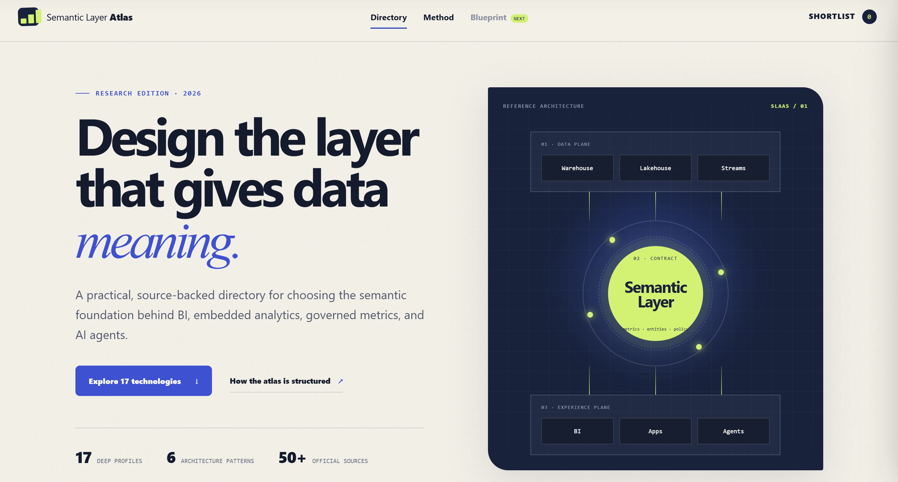

# Semantic Layer Atlas

Semantic Layer Atlas is a static research website for discovering and comparing semantic-layer technologies.



The current site includes:

- A searchable directory of semantic-layer products and standards
- A dedicated profile page for each technology
- Shortlisting and comparison tools
- A LookML implementation guide with 68 searchable business situations, semantic rules, code patterns, and caveats
- An Apache Ossie `0.3.0.dev0` field guide covering the same 68 situations as core examples, source/runtime boundaries, or explicit unsupported cases
- A Snowflake Semantic Views (Cortex) field guide covering the same 68 situations with current YAML/DDL patterns and explicit platform or source boundaries
- A Databricks Genie Agents field guide covering the same 68 situations with Unity Catalog metric-view YAML, trusted-Agent patterns, governance/source boundaries, and explicit unsupported cases
- A Cube field guide covering the same 68 situations with current YAML, Tesseract-aware calculations, access policies, pre-aggregations, and explicit source or consumer boundaries

## Run locally with Python

The deployable website is already contained in `dist`, so there is no dependency installation or build step.

From this directory, start a local server with Python 3:

```bash
python -m http.server 8000 --directory dist
```

On Windows, if Python is registered through the Python launcher, use:

```powershell
py -m http.server 8000 --directory dist
```

Then open:

- Directory: [http://localhost:8000/](http://localhost:8000/)
- LookML profile: [http://localhost:8000/technology/lookml/](http://localhost:8000/technology/lookml/)
- LookML use-case guide: [http://localhost:8000/technology/lookml/use-cases/](http://localhost:8000/technology/lookml/use-cases/)
- Apache Ossie profile: [http://localhost:8000/technology/apache-ossie/](http://localhost:8000/technology/apache-ossie/)
- Apache Ossie use-case guide: [http://localhost:8000/technology/apache-ossie/use-cases/](http://localhost:8000/technology/apache-ossie/use-cases/)
- Snowflake Semantic Views profile: [http://localhost:8000/technology/snowflake-semantic-views/](http://localhost:8000/technology/snowflake-semantic-views/)
- Snowflake Semantic Views use-case guide: [http://localhost:8000/technology/snowflake-semantic-views/use-cases/](http://localhost:8000/technology/snowflake-semantic-views/use-cases/)
- Databricks Genie Agents profile: [http://localhost:8000/technology/databricks-genie/](http://localhost:8000/technology/databricks-genie/)
- Databricks Genie Agents use-case guide: [http://localhost:8000/technology/databricks-genie/use-cases/](http://localhost:8000/technology/databricks-genie/use-cases/)
- Cube profile: [http://localhost:8000/technology/cube/](http://localhost:8000/technology/cube/)
- Cube use-case guide: [http://localhost:8000/technology/cube/use-cases/](http://localhost:8000/technology/cube/use-cases/)

Stop the server with `Ctrl+C`.

If port `8000` is already in use, choose another port, for example:

```bash
python -m http.server 8080 --directory dist
```

## Project structure

```text
.
├── dist/                      # Complete static website
│   ├── index.html             # Technology directory
│   ├── technology/            # Technology profile routes
│   ├── lookml-use-cases.js    # The 68 LookML implementation patterns
│   ├── apache-ossie-use-cases.js # Matching Ossie patterns and support states
│   ├── snowflake-semantic-views-use-cases.js # Matching Snowflake patterns and boundaries
│   ├── databricks-genie-use-cases.js # Matching Genie/metric-view patterns and boundaries
│   ├── cube-use-cases.js     # Matching Cube YAML patterns and boundaries
│   ├── use-cases.js           # Shared search, filter, deep-link, and copy behavior
│   ├── data.js                # Technology directory data
│   ├── app.js                 # Directory and profile behavior
│   └── styles.css             # Shared visual system
└── README.md
```

## Notes

- The website uses absolute paths such as `/styles.css`, so serve `dist` as the web root instead of opening HTML files directly.
- Apache Ossie examples target the mutable draft `0.3.0.dev0`; verify them against the current official schema and producer/consumer implementations.
- Unsupported Ossie cases intentionally have no fake YAML or vendor-extension workaround.
- Snowflake examples reflect the November 2026 Semantic View surface; some LOD, range, and many-to-many capabilities are still documented as preview and can differ between Semantic SQL and Cortex consumers.
- Databricks examples reflect the November 2026 Genie Agent and metric-view surface. Runtime-dependent features state their minimum version, and Agent instructions are never treated as access control.
- Cube examples reflect the November 2026 modeling surface, including Tesseract-era multi-stage measures, switch parameters, calendar cubes, access policies, and pre-aggregation behavior.
- LookML, Ossie, Snowflake, Databricks, Cube, and SQL examples are implementation templates. Validate grain, dialect support, joins, access controls, and performance in the target platform.
